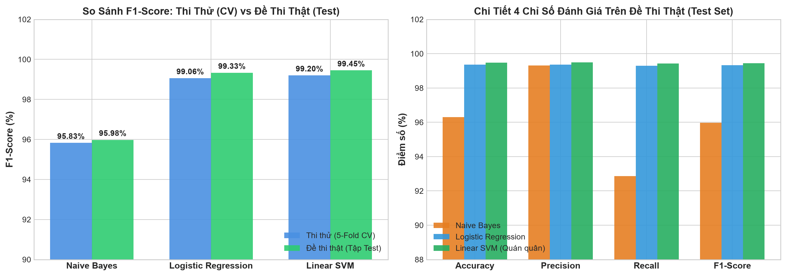
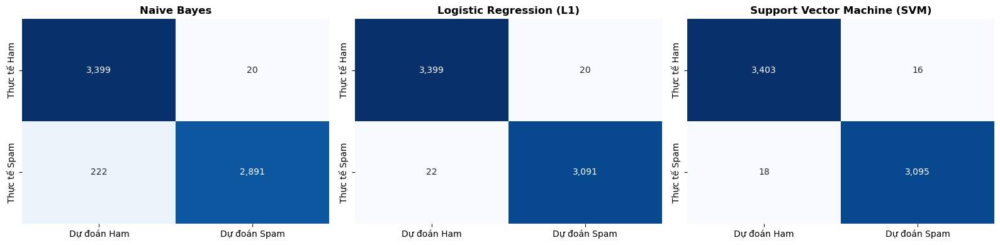
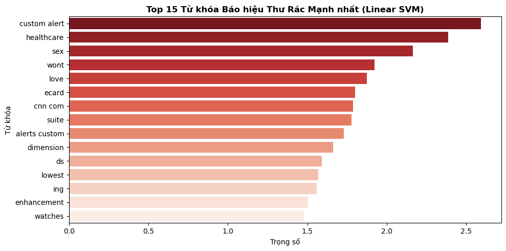

# CẨM NANG TRỰC QUAN HÓA KẾT QUẢ 3 THUẬT TOÁN (SPAMGUARD-ML)

## 1. Bảng Đối Đầu: "Thi Thử" (5-Fold CV) vs "Đề Thi Thật" (Tập Test)

| Thuật toán | F1 Ban đầu (CV) | F1 Tinh chỉnh (CV) | F1 Đề thi thật (Test) | Độ chính xác (Accuracy) | ROC-AUC |
| :--- | :---: | :---: | :---: | :---: | :---: |
| **Linear SVM** | 98.91% | **99.20%** | **99.45%** | **99.48%** | **0.9997** |
| **Logistic Regression** | 98.34% | 99.06% | 99.33% | 99.36% | 0.9995 |
| **Naive Bayes** | 92.76% | 95.83% | 95.98% | 96.30% | 0.9982 |

* **Đúc kết:** Khi bước ra "đề thi thật" (6.532 mẫu kiểm tra), cả 3 mô hình đều đạt điểm cao hơn "thi thử", chứng minh hệ thống học bài rất chuẩn, hoàn toàn không bị học vẹt (Zero Overfitting).

---

## 2. Trực Quan Hóa Sai Số Thực Tế (Confusion Matrix)

* **Bắt nhầm thư quan trọng (FP - False Positive):**
  - **Linear SVM an toàn nhất:** Chỉ bắt nhầm **16 thư** (0.47%), hạn chế tối đa nguy cơ làm thất lạc email công việc.
  - **Logistic Regression & Naive Bayes:** Bắt nhầm **20 thư** (0.58%).
* **Bỏ sót thư rác (FN - False Negative):**
  - **Linear SVM & Logistic Regression:** Chặn rác triệt để (chỉ lọt lưới 18 và 22 thư).
  - **Naive Bayes bỏ sót nhiều nhất:** Để lọt tới **222 thư rác** do giả định các từ khóa xuất hiện độc lập bị vi phạm trong thực tế.

---

## 3. Top 15 Từ Khóa Báo Hiệu Thư Rác Mạnh Nhất

* **Đúc kết 3 nhóm lừa đảo thực tế:**
  1. *Cảnh báo & Dịch vụ giả mạo:* `custom alert`, `cnn com`, `alerts custom`, `suite`.
  2. *Biệt dược & Sinh lý nhạy cảm:* `healthcare`, `sex`, `enhancement`, `dimension`.
  3. *Lừa đảo quà tặng & Giảm giá sốc:* `ecard`, `lowest`, `watches`.

---

## 4. Quyết Định Đóng Gói Triển Khai
* Chọn **Linear SVM** làm mô hình quán quân (`best_model.joblib`) tích hợp vào Web App Streamlit (`app.py`) và CLI (`scripts/run_predict.py`) vì vừa đạt F1 cao nhất (99.45%), vừa an toàn nhất cho người dùng (chỉ 16 ca bắt nhầm).
